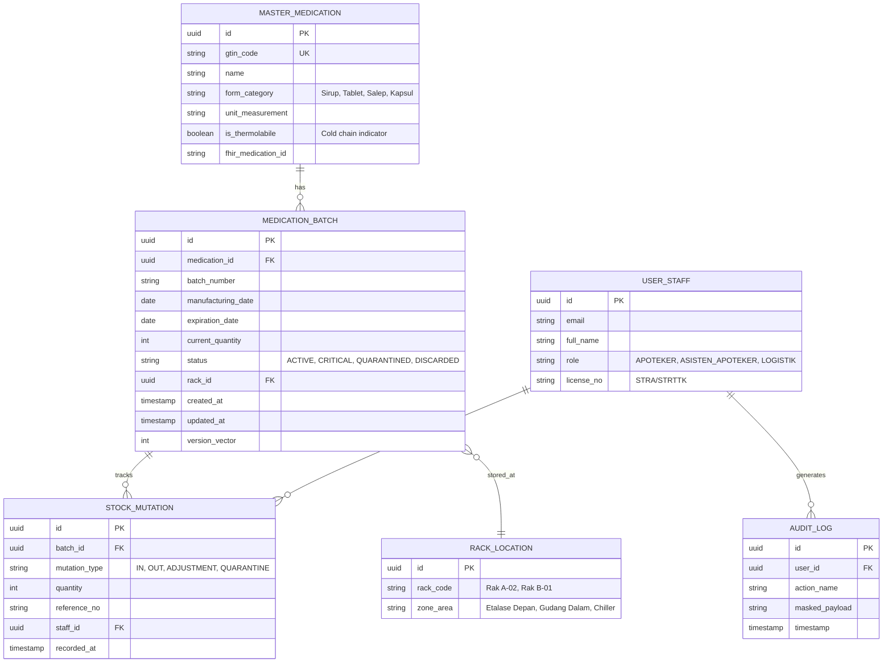
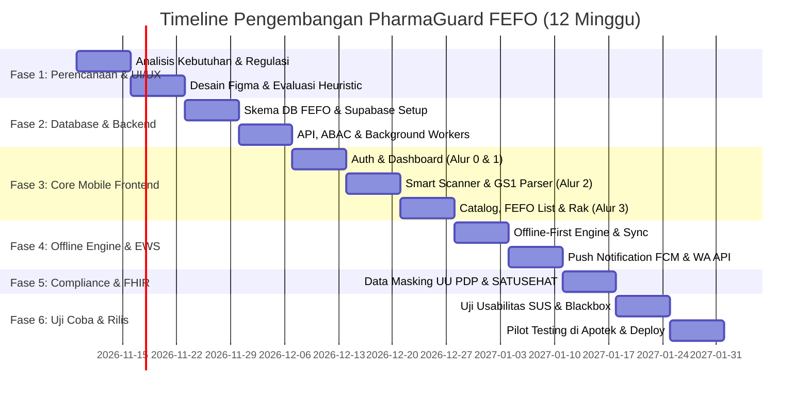

# Rancangan Kerja Komprehensif (Work Plan)
## Pengembangan Sistem Informasi Manajemen Inventaris Obat Berbasis Mobile (PharmaGuard)
### Integrasi Cetak Biru UI/UX Minimalis & Penerapan Standar Algoritma FEFO Komprehensif

---

## 1. Ringkasan Eksekutif & Visi Proyek

Berdasarkan sintesis antara **[Blueprint Obat.docx](file:///c:/Users/ThinkPad/Documents/BLUEPRINT%20GRAVITY/Blueprint%20Obat.docx)** (konsep antarmuka *PharmaGuard* yang bersih, minim beban kognitif, dan aksi cepat 5 detik) serta dokumen akademik **[Analisis Komprehensif Penerapan Metode FEFO pada Sistem Informasi Manajemen Inventaris Obat Berbasis Mobile](file:///c:/Users/ThinkPad/Documents/BLUEPRINT%20GRAVITY/Analisis%20Komprehensif%20Penerapan%20Metode%20FEFO%20pada%20Sistem%20Informasi%20Manajemen%20Inventaris%20Obat%20Berbasis%20Mobile.docx)**, dirumuskan sebuah rancangan kerja implementasi sistem manajemen inventaris farmasi modern yang tangguh, proaktif, dan patuh regulasi.

Proyek ini bertujuan menciptakan aplikasi mobile bernama **"PharmaGuard"** yang tidak hanya memiliki tampilan antarmuka yang ramah pengguna (*user-friendly*), tetapi juga menutup 6 kesenjangan penelitian (*research gaps*) utama:
1. **Otomatisasi Input Data**: Ekstraksi multi-variabel otomatis via standar barcode 2D **GS1 DataMatrix** (AI 01: GTIN, AI 10: Batch, AI 17: Expiry Date).
2. **Resiliensi Jaringan**: Penerapan arsitektur **Offline-First** dengan basis data lokal dan resolusi konflik asinkron.
3. **Peringatan Proaktif**: Sistem peringatan dini (*Early Warning System / EWS*) berbasis FCM & WhatsApp API untuk batas kedaluwarsa berjenjang (BPOM 90-180 hari & kritis H-5).
4. **Logika FEFO Presisi**: Algoritma rotasi stok berbasis nomor batch dan sisa masa simpan (*remaining shelf-life*).
5. **Kepatuhan Privasi (UU PDP No. 27/2022)**: Pengamanan data rekam obat melalui *Attribute-Based Access Control* (ABAC) dan *Data Masking*.
6. **Interoperabilitas Nasional**: Pemetaan skema inventaris ke standar **HL7 FHIR** untuk integrasi dengan ekosistem **SATUSEHAT Kemenkes RI**.

---

## 2. Sasaran & Key Performance Indicators (KPI)

| Parameter | Baseline / Kondisi Konvensional | Target Capaian Proyek PharmaGuard |
| :--- | :--- | :--- |
| **Tingkat Obat Kedaluwarsa** | 18% – 24% dari total stok | **< 0,5%** (Memenuhi standar toleransi Kemenkes/BPOM < 1%) |
| **Kecepatan Input Obat Masuk** | ~45-60 detik per item (manual ketik batch & tgl) | **< 3 detik per item** (Scan 1x GS1 DataMatrix langsung ekstrak batch & tgl) |
| **Ketergantungan Internet** | 100% lumpuh saat offline | **100% operasional transaksi offline** (Sync otomatis saat koneksi pulih) |
| **Skor Usabilitas Antarmuka** | Sistem lama sering rumit & lambat | **System Usability Scale (SUS) > 82.5** (Grade A / Excellent) |
| **Kecepatan Tanggap Obat Kritis** | Menunggu stok opname 1-3 bulan | **Deteksi seketika (H-5 push alert)** & 1-tap karantina |
| **Kepatuhan Regulasi** | Standar database silo/ad-hoc | **100% patuh UU PDP No. 27/2022 & HL7 FHIR SATUSEHAT Ready** |

---

## 3. Arsitektur Teknologi & Spesifikasi Sistem

```mermaid
graph TD
    subgraph Client Layer (Mobile App - Flutter)
        UI[UI/UX PharmaGuard<br/>Auth, Dashboard, Catalog, Settings]
        Scanner[Scanner Engine<br/>Camera ML Kit + GS1 DataMatrix Parser]
        FEFOLogic[Local FEFO Queue Manager]
        LocalDB[(Local SQLite / Isar DB<br/>Timestamped Data Versioning)]
    end

    subgraph Sync & Security Gateway
        SyncManager[Offline-First Sync Engine<br/>Bidirectional Replication & Conflict Resolver]
        ABAC[ABAC & Data Masking Engine<br/>UU PDP Compliance Tier]
    end

    subgraph Backend & Cloud Layer
        Supabase[(Cloud Database - Supabase PostgreSQL)]
        AuthService[Supabase / Google Workspace SSO]
        CronEWS[EWS Scheduler / Edge Functions<br/>Evaluasi Sisa Hari H-5, H-30, H-90]
        FCMService[Firebase Cloud Messaging & WA Gateway]
    end

    subgraph National Health Ecosystem
        FHIRAdapter[HL7 FHIR Adapter]
        SATUSEHAT[SATUSEHAT Kemenkes RI API]
    end

    UI --> Scanner
    Scanner --> FEFOLogic
    UI --> FEFOLogic
    FEFOLogic --> LocalDB
    LocalDB <--> SyncManager
    SyncManager --> ABAC
    ABAC <--> Supabase
    AuthService --> UI
    CronEWS --> Supabase
    CronEWS --> FCMService
    FCMService --> UI
    Supabase --> FHIRAdapter
    FHIRAdapter --> SATUSEHAT
```

### Spesifikasi Tumpukan Teknologi (Tech Stack)
* **Frontend Mobile**: Flutter (Dart) — performa tinggi 60 FPS, multiplatform (Android/iOS), rendering mesin Impeller/Skia.
* **Database Lokal (Offline)**: SQLite (melalui Drift/sqflite) atau Isar DB dengan *Timestamped Data Versioning* untuk mencatat setiap mutasi secara lokal.
* **Backend as a Service (BaaS)**: Supabase (PostgreSQL, Realtime subscription, Auth, Storage, Edge Functions).
* **Scanner Library**: Google ML Kit Barcode Scanning + *Custom GS1 Application Identifier (AI) Parser* (Regex parsing: `01` GTIN, `10` Batch, `17` Expiry YYMMDD).
* **Push Notification Service**: Firebase Cloud Messaging (FCM) + Integrasi WhatsApp Gateway (Fonnte API) untuk peringatan darurat.
* **Interoperabilitas**: Python / Node.js Microservices/Edge Function yang mengubah data tabel obat ke resource HL7 FHIR (`Medication`, `MedicationKnowledge`, `InventoryItem`).

---

## 4. Desain Skema Basis Data Terstruktur (FEFO-Ready)

Untuk mendukung algoritma FEFO, skema database tidak boleh hanya menyimpan produk secara generik, melainkan menerapkan relasi *One-to-Many* antara Master Obat dan Batch:



---

## 5. Rincian Modul & Fungsionalitas Aplikasi

### Modul 1: Autentikasi & Manajemen Akses Petugas (Alur 0)
* **Desain UI**: Layar bersih, logo PharmaGuard, *segmented pill* ("Masuk" / "Daftar Akun"), tombol besar teal, opsi SSO Google Workspace Apotek.
* **Keamanan & UU PDP**: Validasi kredensial terenkripsi bcrypt/Argon2. Penerapan *Attribute-Based Access Control* (ABAC) sehingga petugas logistik gudang hanya bisa memanipulasi mutasi batch tanpa akses ke data peresepan klinis pasien.

### Modul 2: Beranda & Early Warning System (Alur 1)
* **Desain UI**: Salam ramah petugas apotek ("Halo, Apoteker Pija"), *Hero Warning Card* warna coral-red menyala berisi jumlah obat mendekati kedaluwarsa (`<= 5 Hari`), daftar kartu obat perlu tindakan.
* **Fitur Utama**:
  * Peringatan H-5 (Sisa <= 5 Hari): Badge merah mencolok.
  * Peringatan H-30 / H-90: Badge kuning perhatian (sesuai standar karantina BPOM 3-6 bulan).
  * 1-Tap Aksi Karantina: Dari detail obat, klik tombol **"Tarik Obat dari Rak (Karantina)"** mengubah status batch menjadi `QUARANTINED` seketika.

### Modul 3: Smart Barcode Scanner & Perekaman GS1 DataMatrix (Alur 2)
* **Desain UI**: Viewfinder kamera modern dengan garis pemindaian bercahaya, sudut pandang bulat, dan bottom sheet input modal otomatis.
* **Fitur Utama**:
  * **Dual Engine Scanning**: Mendukung Barcode Linier 1D (EAN-13) dan Kode Matriks 2D (GS1 DataMatrix).
  * **GS1 AI Parser Otomatis**: Jika memindai GS1 DataMatrix, sistem otomatis mengekstrak:
    * `AI (01)` $\rightarrow$ Kode GTIN / Nama Obat
    * `AI (10)` $\rightarrow$ Nomor Batch
    * `AI (17)` $\rightarrow$ Tanggal Kedaluwarsa (format YYMMDD)
  * Form input terisi otomatis (*zero manual typing*), pengguna cukup mengonfirmasi jumlah unit dan klik **"Simpan Data Obat"**.

### Modul 4: Katalog & Pencarian Stok Berbasis FEFO (Alur 3)
* **Desain UI**: Search bar responsif, filter chips horizontal (`Semua`, `Kritis H-5`, `Sirup`, `Tablet`, `Salep`).
* **Fitur Utama**:
  * Pengurutan otomatis (*Dynamic FEFO Sorting*): Obat dengan masa simpan terpendek selalu berada di urutan teratas.
  * Indikator lokasi rak fisik (misal: "Rak Sirup • Rak A-02") untuk mempermudah penarikan fisik oleh petugas.
  * Kartu obat interaktif dengan status warna: Merah (Kritis $\le$ 5 hari), Kuning (Perhatian $\le$ 30 hari), Hijau (Aman).

### Modul 5: Mesin Offline-First & Sinkronisasi Latar Belakang
* **Fitur Utama**:
  * Operasi *Write-Ahead* ke database SQLite lokal saat apotek mengalami putus sinyal internet.
  * Log mutasi antrean (*Mutation Queue*) yang mencatat setiap aksi penambahan, pengurangan, dan karantina stok.
  * *Bidirectional Background Sync*: Begitu koneksi aktif kembali, *Sync Manager* mengeksekusi replikasi ke Supabase Cloud dengan aturan *Timestamped Data Versioning* & resolusi konflik otomatis.

### Modul 6: Kepatuhan Hukum & Interoperabilitas (UU PDP & SATUSEHAT)
* **Fitur Utama**:
  * *Data Masking* pada log audit pergerakan obat.
  * Modul adapter REST API untuk mentransmisikan pergerakan obat ke SATUSEHAT menggunakan resource standard `HL7 FHIR Medication`.
  * Menu pengaturan akun petugas: pengelolaan sesi login, status sambungan cloud Supabase, dan switch toggle notifikasi EWS.

---

## 6. Jadwal & Rencana Tahapan Kerja (12 Minggu / 6 Fase)



### Rincian Pelaksanaan Mingguan

#### Minggu 1: Inisiasi Proyek & Analisis Kebutuhan
* Memvalidasi pedoman BPOM, Permenkes No. 73/2016, dan spesifikasi GS1 DataMatrix untuk sediaan farmasi di Indonesia.
* Finalisasi dokumen *Software Requirements Specification* (SRS) dan kamus data.

#### Minggu 2: Desain Antarmuka UI/UX (Figma / Google Stitch)
* Mewujudkan prototipe interaktif 5 layar utama berdasarkan Prompt Google Stitch pada *Blueprint Obat*:
  1. *Clean Auth Screen* (Masuk / Daftar Akun).
  2. *Clean Pharmacy Dashboard* (Hero Warning Card H-5).
  3. *Simple Medicine Detail & Action* (Tarik Obat dari Rak).
  4. *Quick Add Medicine Screen* (Kamera Viewfinder & GS1 Form).
  5. *All Medicine List & Catalog* (Filter Chips & Status Sisa Hari).
* Melakukan evaluasi heuristik dan *Click-through Test* agar alur dapat dipahami dalam 5 detik.

#### Minggu 3: Perancangan Arsitektur Database & Backend Supabase
* Setup proyek Supabase, inisialisasi PostgreSQL dengan tabel master obat, batch, lokasi rak, mutasi, dan audit log.
* Mengonfigurasi *Row-Level Security* (RLS) dan kebijakan otentikasi.

#### Minggu 4: Implementasi Business Logic & API
* Membangun fungsi RPC / View di PostgreSQL untuk perhitungan otomatis antrean FEFO:
  $$\text{Sort By: } \text{expiration\_date ASC, current\_quantity > 0, status = 'ACTIVE'}$$
* Setup Supabase Edge Functions untuk penjadwalan harian evaluasi obat mendekati kedaluwarsa (Cron Job jam 07:00 pagi setiap hari).

#### Minggu 5: Pengembangan Frontend Mobile — Autentikasi & Beranda
* Inisialisasi proyek Flutter, konfigurasi tema warna (*Clean White with Soft Teal Accents & Coral-Red Alerts*).
* Membangun Layar Masuk/Daftar (Alur 0) dan Layar Beranda dengan Hero Card H-5 & Daftar Perlu Tindakan (Alur 1).

#### Minggu 6: Pengembangan Fitur Pemindai Kamera & GS1 DataMatrix Parser
* Integrasi Google ML Kit Barcode Scanning pada Flutter.
* Pembuatan modul parser string GS1 untuk membedah identifier `(01)`, `(10)`, dan `(17)`.
* Pembuatan form input cepat (Alur 2) dengan pengisian otomatis nomor batch dan tanggal kedaluwarsa.

#### Minggu 7: Pengembangan Katalog Obat & Rincian Obat
* Membangun Layar Daftar Obat (Alur 3) dengan filter dinamis (`Semua`, `Kritis H-5`, `Sirup`, `Tablet`, `Salep`).
* Membangun Layar Rincian Obat dengan tombol aksi **"Tarik Obat dari Rak (Karantina)"** yang langsung memicu mutasi status batch.

#### Minggu 8: Implementasi Arsitektur Offline-First & Sinkronisasi
* Konfigurasi SQLite lokal pada Flutter menggunakan Drift/Isar.
* Implementasi algoritma sinkronisasi dua arah:
  * Cache semua data batch secara lokal.
  * Antrean transaksi lokal (*local transaction queue*) saat kondisi internet offline.
  * Pengiriman batch mutasi saat online dengan mekanisme resolusi *Timestamped Data Versioning*.

#### Minggu 9: Integrasi Early Warning System (FCM & WhatsApp API)
* Menghubungkan Supabase Edge Function ke Firebase Cloud Messaging (FCM) untuk pengiriman notifikasi pop-up otomatis ke perangkat petugas.
* Integrasi opsi WhatsApp Gateway (Fonnte API) untuk mengirim rekapitulasi obat H-5 ke grup operasional apotek.

#### Minggu 10: Penerapan Keamanan UU PDP & Interoperabilitas SATUSEHAT (HL7 FHIR)
* Implementasi *Data Masking* pada audit log dan pemisahan hak akses staf (ABAC).
* Pembuatan endpoint adapter yang mengekspor data obat ke resource HL7 FHIR:
  * Resource `Medication` (deskripsi produk, GTIN, sediaan).
  * Resource `InventoryItem` / `MedicationStatement` (nomor batch, tanggal kedaluwarsa, kuantitas stok).

#### Minggu 11: Pengujian Sistem Menyeluruh & Evaluasi SUS
* *Automated Testing*: Unit test logika FEFO, parser GS1, dan algoritma resolusi konflik offline.
* *Stress Testing*: Simulasi pemutusan koneksi saat transaksi dan pengujian latensi pemindaian kamera.
* *Usability Testing*: Melakukan uji coba terhadap 10-15 tenaga teknis kefarmasian / apoteker menggunakan kuesioner **System Usability Scale (SUS)** dengan target skor minimal 82.5.

#### Minggu 12: Deployment, Pilot Testing di Apotek Mitra & Dokumentasi
* Penerbitan build APK / Android App Bundle dan iOS TestFlight.
* Uji coba lapangan (*pilot study*) di apotek mitra selama 7 hari operasional.
* Penyusunan buku manual pengguna (*User Manual Guide*), dokumentasi API, dan laporan serah terima proyek.

---

## 7. Matriks Alokasi Tim & Tanggung Jawab (RACI Matrix)

| Peran Tim | Tanggung Jawab Utama | Rincian Keterlibatan |
| :--- | :--- | :--- |
| **Product Owner / Apoteker Ahli** | Pengarah Kebutuhan Klinis & Regulasi | Menentukan ambang batas peringatan obat, validasi alur karantina BPOM, dan uji akseptabilitas farmasi. |
| **UI/UX Designer** | Perancang Antarmuka & Usabilitas | Mengimplementasikan desain bersih PharmaGuard, memastikan tata letak ramah ketukan jari, memimpin pengujian skor SUS. |
| **Mobile Lead (Flutter Dev)** | Arsitektur Aplikasi Ponsel | Membangun UI Flutter, pemindai GS1 DataMatrix, integrasi database lokal SQLite, dan alur offline-first. |
| **Backend & Cloud Engineer** | Arsitektur Data & Integrasi | Mengonfigurasi Supabase PostgreSQL, Edge Functions cron EWS, integrasi FCM/WhatsApp, dan adapter HL7 FHIR. |
| **QA & Security Specialist** | Pengujian & Kepatuhan UU PDP | Melakukan blackbox testing, audit keamanan data pribadi, verifikasi enkripsi, dan pengujian keandalan jaringan. |

---

## 8. Analisis & Mitigasi Risiko Proyek

| Risiko Potensial | Tingkat Risiko | Dampak | Rencana Aksi Mitigasi |
| :--- | :---: | :---: | :--- |
| **Kondisi Kamera & Pencahayaan Redup di Gudang** | Sedang | Pemindaian barcode melambat (latensi > 2 detik) | Sediakan fitur *flashlight toggle* otomatis dalam viewfinder dan sediakan mode input manual fallback dengan pencarian autocomplete nama obat. |
| **Konflik Data Saat Transaksi Multi-Petugas Offline** | Tinggi | Stok terhitung ganda atau urutan FEFO tidak konsisten | Terapkan *Timestamped Data Versioning* dengan aturan validasi di sisi server (jika stok fisik tidak mencukupi, mutasi masuk status *pending review*). |
| **Perubahan Format Spesifikasi API SATUSEHAT** | Sedang | Interoperabilitas ke Kemenkes terhambat | Bungkus modul integrasi SATUSEHAT dalam lapisan *middleware microservice* independen sehingga perubahan skema FHIR tidak mengganggu kode aplikasi mobile utama. |
| **Resistensi Petugas Apotek terhadap Sistem Baru** | Sedang | Tingkat adopsi rendah, kembali mencatat manual | Ikuti secara kaku pedoman *Blueprint Obat*: tombol besar, minim teks berlebih, 0 konfigurasi rumit, serta adakan sesi pelatihan singkat (15 menit). |
| **Risiko Pelanggaran UU PDP No. 27/2022** | Tinggi | Sanksi administratif dan hukum terhadap klinik/apotek | Terapkan ABAC dan Data Masking sejak *database tier*; data identitas pasien sama sekali tidak disimpan atau ditampilkan di modul inventaris obat murni. |

---

## 9. Rencana Kerja Tindak Lanjut (Immediate Next Steps)

Untuk memulai eksekusi rancangan kerja ini, langkah-langkah prioritas yang dapat segera diambil adalah:
1. **Persetujuan Ruang Lingkup & Desain**: Menyetujui sketsa antarmuka dan batasan modul sesuai 5 layar *Blueprint Obat*.
2. **Inisialisasi Repositori & Boilerplate Proyek**: Membuat struktur folder proyek Flutter dengan arsitektur bersih (*Clean Architecture / BLoC / Riverpod*) dan setup proyek Supabase.
3. **Pengembangan Modul Prototipe Inti (MVP)**:
   - Membuat mesin pemindai barcode 2D GS1 DataMatrix.
   - Menguji logika kalkulasi antrean FEFO pada database lokal.
4. **Verifikasi Awal**: Uji coba pemindaian pada 5-10 kotak obat fisik asli yang memiliki barcode GS1 DataMatrix dan EAN-13.
